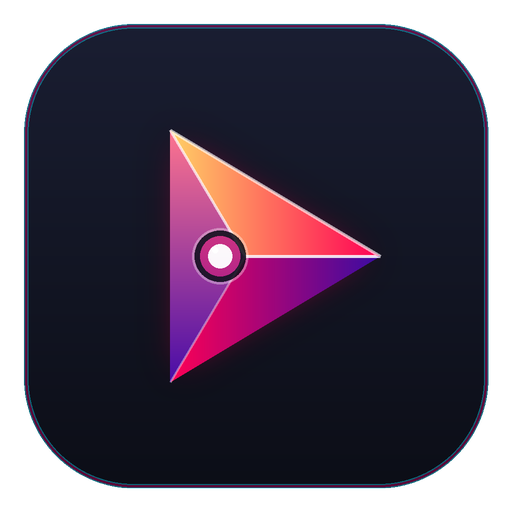

# VC-Record – Lightweight Windows Screen Recorder

<div align="center">
  
  <h2>VC-Record Pro</h2>
  <p><strong>Capture • Create • Share</strong></p>
  <p>Production-ready, lightweight, native-feeling Windows desktop screen recorder with 3D glassmorphic UI.</p>

  <p>
    <a href="https://github.com/venkateshcreations/VC-Record">
      
    </a>
    <a href="https://venkateshcreations.github.io/portfolio/">
      
    </a>
    <a href="LICENSE">
      
    </a>
    
    
  </p>
</div>

---

## 📸 Overview

**VC-Record** is a modern, privacy-focused, zero-cloud Windows desktop recording studio engineered for content creators, software developers, educators, and gamers. Built with hardware-accelerated video processing pipelines, custom draggable region selection, dual-channel audio mixing, and 100% offline local storage.

### 🎨 Visual Design
* **Glassmorphic UI**: Ultra-clean dark glass theme (`#0e111a` / `#141726`) with ambient cosmic neon glows (cyan, pink, amber, emerald).
* **3D Action Cards**:
  1. 🔴 **Record Screen**: Full screen, multi-monitor selection, custom draggable region, or active window capture.
  2. 🔵 **Record Webcam**: Standalone camera recording with real-time preview and microphone input.
  3. 🟢 **Record Audio**: Dedicated microphone, system sound (WASAPI loopback), or combined stereo audio recording with real-time visualizer.
  4. 🟡 **Screenshot**: Fullscreen or custom region area capture with automatic Windows Clipboard copy and preview.
* **Vertical Sidebar**: Fast access to **Home**, **My Recordings**, **Settings**, and **About**.
* **Recordings Library**: Compact glassmorphic cards with thumbnails, digital duration badges, format tags (`PNG`, `MP4`, `MP3`), instant playback, folder location opening, and deletion.

---

## ⚡ Key Features

### 1. Screen Recording
* **Modes**: Full screen, monitor picker (for multi-display setups), custom interactive region with dimension indicator, or active window.
* **Resolution**: Original display resolution, 1080p Full HD, 720p HD, 480p SD.
* **Frame Rates**: 15, 24, 30, 60 FPS.
* **Formats**: MP4 (optimized with `+faststart` for immediate playback) and MKV.
* **Hardware Acceleration**: Automatic GPU hardware encoding detection (NVIDIA NVENC `h264_nvenc`, Intel Quick Sync `h264_qsv`, AMD AMF `h264_amf`) with instant CPU fallback to `libx264`.
* **Picture-in-Picture Webcam Overlay**:
  * Circular or rounded rectangular shape with cyan border.
  * Customizable overlay position (Bottom-Right, Bottom-Left, Top-Right, Top-Left).
  * Adjustable size (Small, Medium, Large) and camera mirror option.
* **Custom Countdown**: 3s, 5s, 10s, or instant start.

### 2. Audio Capture & Mixing
* **Dual Audio Mixing**: Simultaneous capture and mixing of microphone input and Windows system loopback audio via Web Audio API.
* **Independent Controls**: Mute/unmute microphone or system audio individually during live recording.
* **Dedicated Audio Mode**: Save recordings as compressed MP3 (192kbps) or lossless WAV (PCM 48kHz).

### 3. Interactive Custom Region Capture
* Fullscreen desktop snapshot overlay with spotlight transparent cutout.
* Live dimension indicator (`W × H px`) during click-and-drag.
* Direct **Confirm (Enter)** and **Cancel (Esc)** buttons.

### 4. Screenshot Tool
* Capture fullscreen or custom regions with a single click.
* Instant auto-copy to Windows Clipboard (`Ctrl+V` anywhere).
* Built-in preview modal with quick "Copy", "Capture Again", and "Open in Explorer" actions.

### 5. Floating Control Bar
* Non-intrusive floating control bar during active screen recordings.
* Real-time timer (`00:03:45`), recording indicator, pause/resume, mic mute, system sound mute, and stop buttons.

### 6. 100% Private & Local
* No user registration, no sign-in, and zero telemetric tracking.
* All video recordings, audio tracks, screenshots, and thumbnails remain strictly on your local disk (`Videos\VC-Record\`).

---

## 🛠 Technology Stack

* **Desktop Runtime**: Electron 33 (64-bit Windows)
* **Frontend UI**: React 18, TypeScript, Tailwind CSS, Lucide Icons
* **Build System**: Vite 5
* **Media Processing**: Static bundled FFmpeg with hardware acceleration
* **Packaging**: Electron Builder (NSIS Installer & Standalone Portable)

---

## 🚀 Getting Started

### Prerequisites
* [Node.js](https://nodejs.org/) (v18 or higher)
* [pnpm](https://pnpm.io/) (`npm install -g pnpm`)

### Installation & Development

```bash
# 1. Clone the repository
git clone https://github.com/venkateshcreations/VC-Record.git

# 2. Navigate to project directory
cd VC-Record

# 3. Install dependencies
pnpm install

# 4. Start Vite development server
pnpm run dev

# 5. In a second terminal, launch Electron
pnpm run electron
```

### Building for Production

```bash
# Build TypeScript and Vite bundles
pnpm run build
pnpm run build:electron

# Package Windows NSIS Installer and Portable Executable
pnpm run dist
```

Generated binaries will be located in the `release/` directory:
* `VC-Record Setup 1.0.0.exe` (Windows Installer)
* `VC-Record 1.0.0.exe` (Standalone Portable)

---

## ⌨️ Default Keyboard Shortcuts

| Action | Shortcut |
| :--- | :--- |
| **Start / Stop Recording** | `Ctrl + Alt + R` |
| **Pause / Resume Recording** | `Ctrl + Alt + P` |
| **Capture Screenshot** | `Ctrl + Alt + S` |
| **Cancel Region Selection** | `Escape` |
| **Confirm Region Selection** | `Enter` |

---

## 👨‍💻 Creator & Author

**Venkatesh Ammireddy**  
* Portfolio: [https://venkateshcreations.github.io/portfolio/](https://venkateshcreations.github.io/portfolio/)  

---

## 📄 License

This project is open-source and licensed under the [MIT License](LICENSE).
